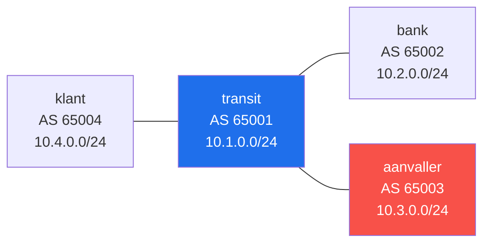
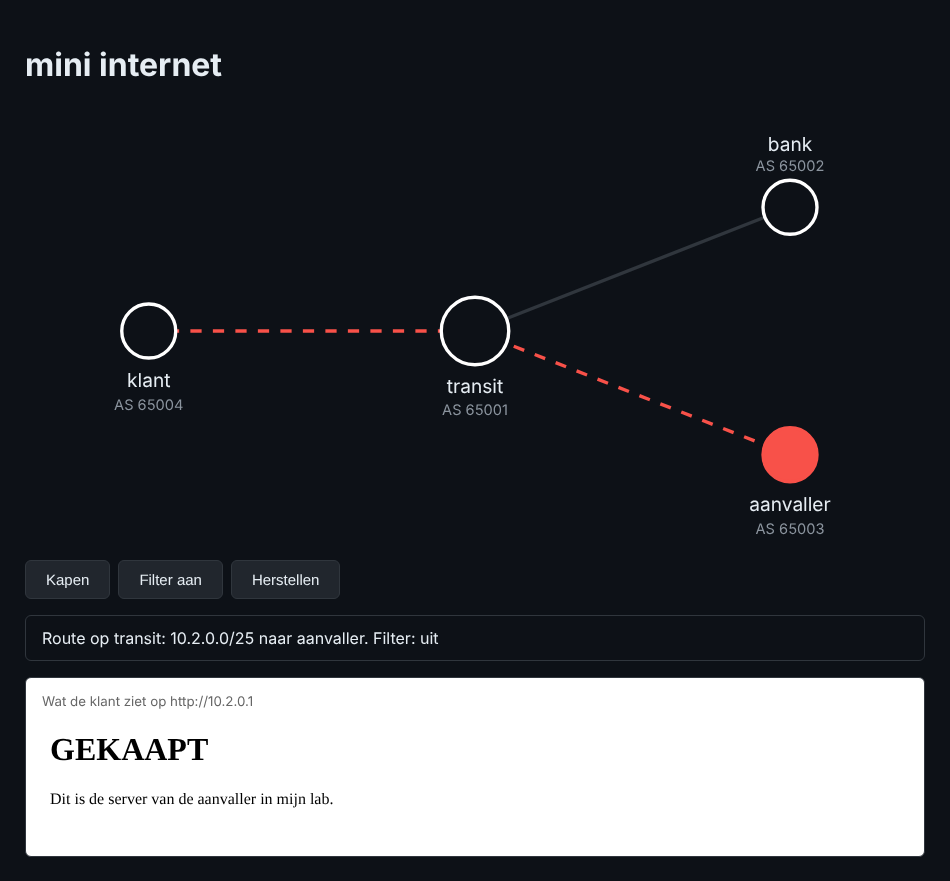
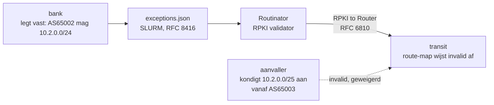
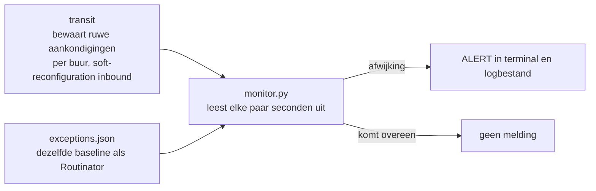

# Mini internet


Een klein internet, nagebouwd op mijn eigen laptop, om te snappen hoe het grote internet
zijn routes regelt en hoe dat fout kan gaan. Het draait volledig lokaal in containers, met
vier routers die doen alsof ze aparte netwerken op het internet zijn. Niets hiervan raakt
een echt netwerk.

Het doel is simpel. Eerst bouw ik iets dat werkt zoals het hoort. Daarna val ik het zelf aan.
Daarna bouw ik de verdediging die een echt netwerk ook zou gebruiken. Zo zie ik met eigen ogen
wat er misgaat als je routing op vertrouwen laat draaien, en wat er nodig is om dat te
voorkomen.

## Inhoud

- [Een paar begrippen voordat je verder leest](#een-paar-begrippen-voordat-je-verder-leest)
- [Hoe het in elkaar zit](#hoe-het-in-elkaar-zit)
- [Status](#status)
- [Aan de slag](#aan-de-slag)
- [Experiment 1: een route kapen](#experiment-1-een-route-kapen)
- [Experiment 2: een prefix-list als handmatige verdediging](#experiment-2-een-prefix-list-als-handmatige-verdediging)
- [Experiment 3: een geldig certificaat kapen](#experiment-3-een-geldig-certificaat-kapen)
- [Experiment 4: RPKI als automatische verdediging](#experiment-4-rpki-als-automatische-verdediging)
- [Experiment 5: een eigen BGP hijack monitor](#experiment-5-een-eigen-bgp-hijack-monitor)
- [Live kaart](#live-kaart)
- [Wat er misging, en waarom](#wat-er-misging-en-waarom)
- [Bronnen](#bronnen)

## Een paar begrippen voordat je verder leest

| Term | Betekenis |
|---|---|
| AS (autonoom systeem) | Een netwerk met een eigen nummer, te vergelijken met een postcode voor een heel bedrijf of provider in plaats van voor één huis. |
| Prefix | Een blok IP adressen dat bij elkaar hoort, bijvoorbeeld 10.2.0.0/24. |
| BGP | Het protocol waarmee AS nummers elkaar vertellen welke prefixen bij hen horen. Standaard wordt dat bericht op vertrouwen aangenomen, zonder bewijs. |
| BGP hijack | Een AS dat ten onrechte een prefix aankondigt die niet van hem is, waardoor verkeer voor die prefix naar hem toe gaat in plaats van naar de echte eigenaar. |
| RPKI | Een systeem waarmee een netwerk cryptografisch kan vastleggen welk AS nummer welke prefix mag aankondigen. |
| ROV (route origin validation) | De controle die een router met behulp van RPKI uitvoert, voordat hij een aankondiging accepteert. |

Met die zes termen is de rest van deze pagina te volgen zonder extra opzoekwerk.

## Hoe het in elkaar zit

Vier routers, elk met een eigen AS nummer en een eigen blok adressen. Transit zit in het
midden en is de enige die met de andere drie praat.



| Router | AS | Netwerk | Rol |
|---|---|---|---|
| transit | 65001 | 10.1.0.0/24 | Verbindt de andere drie met elkaar, en beslist welke routes hij accepteert |
| bank | 65002 | 10.2.0.0/24 | Draait een website, het doelwit van de aanval |
| aanvaller | 65003 | 10.3.0.0/24 | Kondigt valse routes aan om verkeer voor de bank te onderscheppen |
| klant | 65004 | 10.4.0.0/24 | Bezoekt de website van de bank, zoals een gewone gebruiker |

Gebouwd met [Containerlab](https://containerlab.dev) om de topologie te definiëren en
[FRRouting](https://frrouting.org/) als router besturingssysteem in elke container.

## Status

- [x] Drie routers die elkaar bereiken
- [x] Website voor de bank
- [x] Route kapen
- [x] Handmatige verdediging met een prefix-list
- [x] HTTPS en een eigen certificaatautoriteit met ACME
- [x] RPKI als automatische verdediging
- [x] Een eigen monitor die kapingen detecteert
- [x] Live kaart in de browser
- [ ] DNS

## Aan de slag

Nodig: Linux, als Ubuntu in WSL2 of een gewone Ubuntu VM, met Docker en
[Containerlab](https://containerlab.dev) geïnstalleerd.

```bash
sudo containerlab deploy -t topology.clab.yml
```

Controleren of de BGP sessies tot stand zijn gekomen:

```bash
docker exec -it clab-mini-internet-transit vtysh -c "show bgp summary"
```

Testen of de aanvaller de bank kan bereiken:

```bash
docker exec -it clab-mini-internet-aanvaller ping -c 3 -I 10.3.0.1 10.2.0.1
```

Alles weer afbreken:

```bash
sudo containerlab destroy -t topology.clab.yml --cleanup
```

## Experiment 1: een route kapen

De bank kondigt 10.2.0.0/24 aan. Ik laat de aanvaller 10.2.0.0/25 aankondigen, een kleiner
en dus specifieker deel van hetzelfde blok. Een router kiest altijd de meest specifieke
route die hij kent, dus het verkeer voor 10.2.0.1 gaat vanaf dat moment naar de aanvaller,
terwijl de bank zelf niets heeft veranderd.

```bash
sudo bash scripts/kaping.sh
```

| Situatie | Route op transit | Gaat naar |
|---|---|---|
| Normaal | 10.2.0.0/24 via 10.255.12.2 | bank |
| Gekaapt | 10.2.0.0/25 via 10.255.13.2 | aanvaller |

Bij de bank en de aanvaller draait een webserver, en de klant vraagt steeds hetzelfde adres
op, http://10.2.0.1. Dat maakt de kaping ook zichtbaar op het niveau van een echte
gebruiker, niet alleen in de routeringstabel.

```bash
sudo bash scripts/bezoek.sh   # Echte bank
sudo bash scripts/kaping.sh
sudo bash scripts/bezoek.sh   # GEKAAPT, zelfde adres, ander antwoord
```

## Experiment 2: een prefix-list als handmatige verdediging

Een prefix-list op transit staat alleen toe dat de aanvaller zijn eigen, echte netwerk
aankondigt.

```
ip prefix-list AANVALLER-IN seq 5 permit 10.3.0.0/24
router bgp 65001
 address-family ipv4 unicast
  neighbor 10.255.13.2 prefix-list AANVALLER-IN in
```

```bash
sudo bash scripts/filter.sh
sudo bash scripts/bezoek.sh   # weer de echte bank
```

Dit werkt, maar is reactief. Iemand moet eerst zien dat er een kaping gaande is, en dan
zelf dit filter toevoegen. Dat is precies het probleem dat RPKI in experiment 4 oplost.

## Experiment 3: een geldig certificaat kapen

De bank heeft een eigen certificaatautoriteit, step-ca, die hetzelfde protocol gebruikt als
Let's Encrypt, genaamd ACME. Voordat die een certificaat uitgeeft voor bank.lab, controleert
hij wie dat domein beheert door een bestand op te halen op het IP adres waar bank.lab naar
wijst.

Tijdens een kaping wijst bank.lab, door de BGP kaping, ineens naar de aanvaller. De
certificaatautoriteit vraagt daar het controlebestand op, krijgt antwoord, en geeft het
certificaat gewoon af aan de aanvaller.

```bash
sudo bash scripts/vraag-certificaat.sh
```

```
subject=CN=bank.lab
issuer=O=Lab CA, CN=Lab CA Intermediate CA
```




Dit is een bekend risico op het echte internet. Een certificaatautoriteit vertrouwt op BGP
om te bepalen wie een domein beheert, dus wie de route kaapt, kan ook een geldig certificaat
krijgen. Dit gebeurde in 2018 ook echt, bij MyEtherWallet.

## Experiment 4: RPKI als automatische verdediging

De prefix-list uit experiment 2 is handwerk. RPKI maakt dit automatisch, met een
cryptografisch bewijs in plaats van een filter dat iemand achteraf moet toevoegen.



Elk netwerk legt vast welk AS nummer welke prefix mag aankondigen, en tot welke lengte. In
een echt netwerk gebeurt dat via een RIR zoals RIPE. Dit lab gebruikt prive adresruimte, dus
komt die vastlegging uit een lokaal bestand, `configs/routinator/exceptions.json`, volgens
SLURM, RFC 8416.

[Routinator](https://nlnetlabs.nl/projects/rpki/routinator/) van NLnet Labs, dezelfde
software die ook in echte netwerken draait, valideert dit en stuurt het resultaat naar
transit via het RPKI to Router protocol, RFC 6810. Een route-map op transit wijst elke
aankondiging die als ongeldig wordt gemarkeerd automatisch af, zonder dat iemand hoeft in
te grijpen.

Het resultaat, de aanvaller voert dezelfde /25 kaping uit als in experiment 1, maar de route
op transit verandert niet. De aankondiging van de aanvaller verschijnt niet eens in de BGP
tabel:

```
Routing entry for 10.2.0.0/24
  Known via "bgp", distance 20, metric 0, best
  * 10.255.12.2, via eth1, weight 1
```

Dezelfde route, voor en na de kaping. Geen mens hoefde in te grijpen.

## Experiment 5: een eigen BGP hijack monitor

RPKI voorkomt dat transit een ongeldige aankondiging gebruikt, maar voorkomen is iets anders
dan weten dat het is geprobeerd. Een Security Operations Center wil een poging zien en
loggen, ook als RPKI die al heeft tegengehouden. Daarvoor bouwde ik `scripts/monitor.py`,
een los proces dat continu kijkt wat transit daadwerkelijk van elke buur ontvangt, van voor
RPKI heeft gefilterd, en dat vergelijkt met dezelfde baseline die Routinator gebruikt.



Dit vereist dat FRR de ruwe, ongefilterde aankondiging per buur bewaart in plaats van alleen
het eindresultaat, met `soft-reconfiguration inbound`, uit te lezen via
`show bgp ipv4 unicast neighbors <ip> received-routes`.

```bash
python3 scripts/monitor.py
```

Zodra de aanvaller de kaping opnieuw uitvoert, meldt de monitor dit binnen enkele seconden,
in dit geval terwijl RPKI de route zelf al had geweigerd:

```
ALERT via buur aanvaller (10.255.13.2): AS65003 kondigt 10.2.0.0/25 aan,
maar alleen AS65002 (bank) is hiervoor geautoriseerd
```

Trekt de aanvaller de aankondiging weer in, met `scripts/herstel.sh`, dan verdwijnt de
melding vanzelf en blijft de monitor stil.

## Live kaart


Een kleine webapp die de topologie en de status van elke route live tekent, zodat een
kaping, een filter of RPKI meteen zichtbaar is, niet alleen in een terminal.

| Normaal | Gekaapt | Geblokkeerd door RPKI |
|---|---|---|
|  |  |  |

```bash
sudo python3 scripts/kaart.py
```

Daarna open je http://localhost:8000.

## Wat er misging, en waarom

Dit project liep niet in één keer goed. De fouten eronder horen er voor mij net zo bij als
de uiteindelijke oplossing, omdat elke fout iets laat zien over hoe BGP, FRR of Linux
containers daadwerkelijk werken, in plaats van hoe de documentatie zegt dat ze werken.

**RPKI module laadde niet in de officiële FRR container image.**
`bgpd_rpki.so` gaf tientallen fouten over symbolen die niet gevonden konden worden, bij het
laden via `ldd`. De oorzaak lag in het image zelf, gebaseerd op Alpine met musl als C
bibliotheek in plaats van glibc, waarbij de meegeleverde RPKI module zijn symbolen niet
correct exporteert voor musl. Opgelost door een eigen FRR image te bouwen op basis van
Debian, met de pakketten uit de officiële FRRouting apt repository, die wel tegen glibc
linken.

**RPKI commando werd niet herkend.**
`rpki cache 127.0.0.1 3323 preference 1` gaf een foutmelding, ook nadat de module wel laadde.
De reden was een verouderd voorbeeld uit de documentatie. De echte versie van FRR die hier
draait, 10.7.1, vereist een expliciet transportprotocol in het commando, `rpki cache tcp
127.0.0.1 3323 preference 1`. Dit is pas duidelijk geworden door het commando rechtstreeks
in vtysh op te vragen met `rpki` gevolgd door `list`, in plaats van op documentatie te
vertrouwen die niet bij deze versie hoort.

**Een snellere herstart brak de transit container.**
Om tijd te besparen probeerde ik `docker restart` in plaats van de hele topologie af te
breken en opnieuw op te bouwen na een configuratiewijziging. Dit liet bgpd 89 seconden
hangen voordat het geforceerd werd afgesloten, met een achtergebleven lock bestand als
gevolg. Een lopende FRR daemon verwerkt een herstart met een aangepast configuratiebestand
niet schoon. Een volledige `containerlab destroy` gevolgd door `containerlab deploy` is
trager, maar wel betrouwbaar.

**RPKI verbond niet vanzelf na het opstarten.**
bgpd doet precies één verbindingspoging naar Routinator op het moment dat zijn configuratie
wordt geladen. Als Routinator op dat moment nog niet volledig is opgestart, mislukt die
poging, en FRR probeert het daarna niet snel genoeg opnieuw. Opgelost door
`scripts/rpki-status.sh` altijd eerst een `rpki reset` te laten uitvoeren voordat de status
wordt opgevraagd.

**Verkeerde WSL distributie geopend.**
Windows kan meerdere Linux distributies naast elkaar draaien onder WSL. Een kaal `wsl`
commando opende de interne `docker-desktop` distributie in plaats van mijn eigen Ubuntu,
waarin `~/mini-internet` niet bestond en `python3` ontbrak. Opgelost met `wsl -l -v` om de
distributies te zien, en `wsl -d Ubuntu` om de juiste te openen.

**sudo wachtwoord bij elke docker opdracht.**
Dit maakte de monitor onbruikbaar, omdat die continu docker commando's uitvoert. De oorzaak
was dat mijn gebruiker niet in de docker groep zat. Opgelost door mezelf aan die groep toe
te voegen, waarna docker commando's zonder sudo werken, zij het pas in een nieuwe sessie.

## Bronnen

- RIPE NCC, Routing Information Service, een voorbeeld van BGP monitoring op
  internetschaal, https://ris.ripe.net/
- Cloudflare Radar, BGP hijack detectie in productie, https://radar.cloudflare.com/
- RFC 4271, A Border Gateway Protocol 4, https://www.rfc-editor.org/rfc/rfc4271
- RFC 6480, An Infrastructure to Support Secure Internet Routing, de basis van RPKI
- RFC 6810, The Resource Public Key Infrastructure to Router Protocol
- RFC 8416, Simplified Local Internet Number Resource Management with the RPKI, SLURM
- RFC 8555, Automatic Certificate Management Environment, ACME,
  https://www.rfc-editor.org/rfc/rfc8555
- NLnet Labs, Routinator documentatie, https://routinator.docs.nlnetlabs.nl/
- [FRRouting documentatie](https://docs.frrouting.org/)
- [Containerlab documentatie](https://containerlab.dev/)
- [Smallstep step-ca documentatie](https://smallstep.com/docs/step-ca/)
- [acme.sh](https://github.com/acmesh-official/acme.sh)
- Gavrichenkov, T. (2019). [Four Years of Breaking HTTPS with BGP Hijacking](https://pc.nanog.org/static/published/meetings/NANOG75/1892/20190219_Gavrichenkov_Four_Years_Of_v1.pdf), NANOG 75.
- The Register (2018). [AWS DNS network hijack turns MyEtherWallet into ThievesEtherWallet](https://www.theregister.com/2018/04/24/myetherwallet_dns_hijack/)
- Goldberg, S. (2018). [The MyEtherWallet.com hijack and why it's risky to hold cryptocurrency in a webapp](https://medium.com/@goldbe/the-myetherwallet-com-hijack-and-why-its-risky-to-hold-cryptocurrency-in-a-webapp-261131fad278)
- SEED Labs, Internet Emulator, een vergelijkbaar lab ter inspiratie, [github.com/seed-labs/seed-emulator](https://github.com/seed-labs/seed-emulator)
