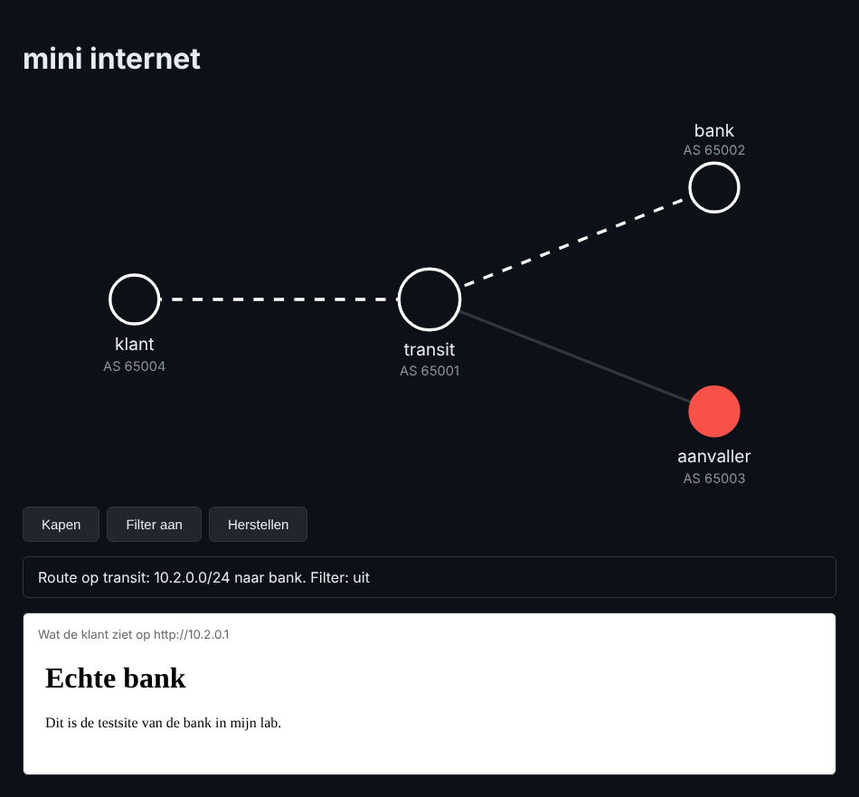
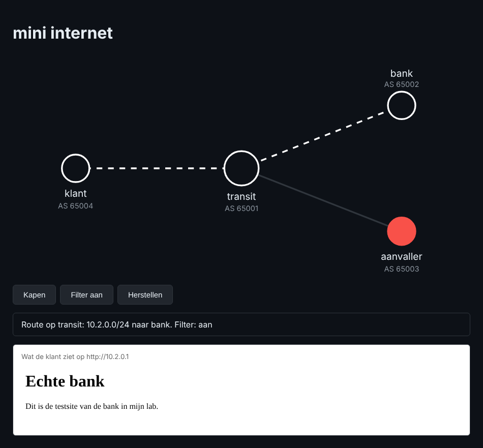
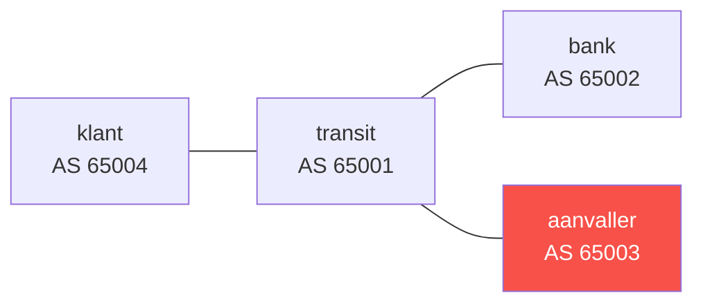
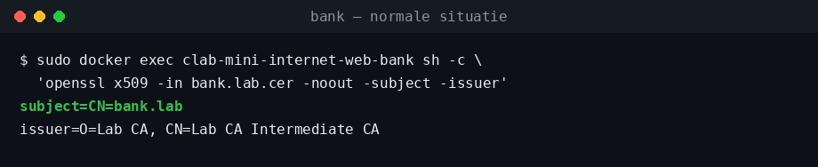
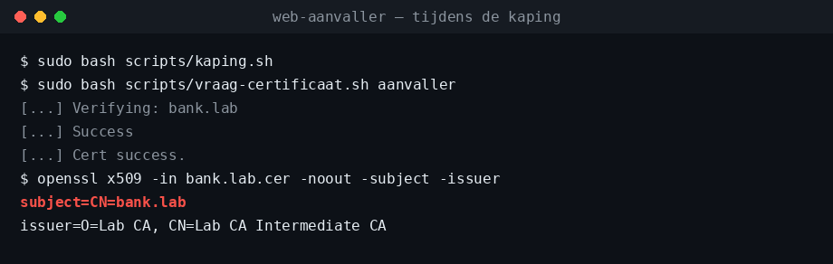

# Mini internet


Ik bouw op mijn laptop een klein internet na om te snappen hoe BGP werkt en hoe je het kunt aanvallen en beveiligen. BGP is het protocol waarmee grote netwerken op internet aan elkaar vertellen welke IP adressen bij hen zitten. Standaard wordt dat vooral op vertrouwen aangenomen, en dat wil ik zelf zien misgaan.

Alles draait lokaal in containers met private IP adressen en AS nummers. Het is niet verbonden met echte routers.

## In beeld


De beelden hieronder laten de kaart in drie situaties zien. Ze zijn gemaakt met testdata die overeenkomt met de uitkomsten in mijn lab.

| Normaal | Gekaapt | Geblokkeerd |
|---|---|---|
|  |  |  |



De kaart start je met `sudo python3 scripts/kaart.py`, daarna open je http://localhost:8000.

## Opbouw nu

| Router | AS | Netwerk |
|---|---|---|
| transit | 65001 | 10.1.0.0/24 |
| bank | 65002 | 10.2.0.0/24 |
| aanvaller | 65003 | 10.3.0.0/24 |
| klant | 65004 | 10.4.0.0/24 |

De bank, de aanvaller en de klant zijn alleen met transit verbonden.

## Nodig

Linux (Ubuntu VM of WSL2), Docker en [Containerlab](https://containerlab.dev).

## Starten

```bash
sudo containerlab deploy -t topology.clab.yml
```

Kijken of de BGP sessies werken:

```bash
docker exec -it clab-mini-internet-transit vtysh -c "show bgp summary"
```

Testen of de aanvaller de bank kan bereiken:

```bash
docker exec -it clab-mini-internet-aanvaller ping -c 3 -I 10.3.0.1 10.2.0.1
```

Stoppen:

```bash
sudo containerlab destroy -t topology.clab.yml
```

De regel `no bgp ebgp-requires-policy` staat er nu in zodat routes zonder filter worden uitgewisseld. Bij de beveiliging ga ik dat aanpassen.

## Planning

- [x] Drie routers die elkaar bereiken
- [x] Website voor de bank
- [ ] DNS
- [x] Route kapen
- [x] HTTPS en eigen CA met ACME
- [ ] Filters en RPKI
- [x] Live kaart in de browser

## Eerste kaping

De bank kondigt 10.2.0.0/24 aan. Ik heb de aanvaller 10.2.0.0/25 laten aankondigen. Omdat een router altijd de meest specifieke route kiest, ging het verkeer voor 10.2.0.1 daarna naar de aanvaller, terwijl er bij de bank niks veranderd was.

| Situatie | Route op transit | Gaat naar |
|---|---|---|
| Normaal | 10.2.0.0/24 via 10.255.12.2 | bank |
| Gekaapt | 10.2.0.0/25 via 10.255.13.2 | aanvaller |
| Met filter | 10.2.0.0/24 via 10.255.12.2 | bank |

Daarna heb ik op transit een filter gezet zodat de aanvaller alleen zijn eigen netwerk mag aankondigen:

```
ip prefix-list AANVALLER-IN seq 5 permit 10.3.0.0/24
router bgp 65001
 address-family ipv4 unicast
  neighbor 10.255.13.2 prefix-list AANVALLER-IN in
```

Het duurde even voordat de route terug was. Eerst dacht ik dat het filter niet werkte, maar bij de tweede controle klopte het wel.

## Website kapen

Bij de bank en de aanvaller draait nu een webserver. De klant vraagt steeds hetzelfde adres op, http://10.2.0.1.

```bash
sudo bash scripts/bezoek.sh   # Echte bank
sudo bash scripts/kaping.sh
sudo bash scripts/bezoek.sh   # GEKAAPT
sudo bash scripts/filter.sh
sudo bash scripts/bezoek.sh   # Echte bank
```

Wacht na het kapen en filteren een paar seconden, de routes zijn niet meteen aangepast. De klant merkt zelf niks, die gebruikt gewoon hetzelfde adres.

## Een geldig certificaat kapen

De bank heeft een eigen certificaatautoriteit (step-ca, met ACME, hetzelfde protocol als Let's Encrypt) die een certificaat uitgeeft nadat hij heeft gecontroleerd wie `bank.lab` beheert. Die controle gebeurt door een bestand op te halen via HTTP, op het IP adres waar `bank.lab` naartoe wijst.

Tijdens een normale situatie krijgt de bank dat certificaat. Tijdens de kaping heb ik gevraagd om hetzelfde certificaat vanaf de server van de aanvaller, en die kreeg het ook:

```
subject=CN=bank.lab
issuer=O=Lab CA, CN=Lab CA Intermediate CA
```





Dit toont een bekend risico in het echte internet: een certificaatautoriteit vertrouwt op BGP om te bepalen wie een domein beheert. Wie de route kaapt, kan daardoor ook een geldig certificaat krijgen. Dit is in 2018 ook echt gebeurd bij MyEtherWallet.

## Bronnen

- [RFC 4271 — A Border Gateway Protocol 4 (BGP-4)](https://www.rfc-editor.org/rfc/rfc4271)
- [RFC 8555 — Automatic Certificate Management Environment (ACME)](https://www.rfc-editor.org/rfc/rfc8555)
- [FRRouting documentatie](https://docs.frrouting.org/)
- [Containerlab documentatie](https://containerlab.dev/)
- [Smallstep step-ca documentatie](https://smallstep.com/docs/step-ca/)
- [acme.sh](https://github.com/acmesh-official/acme.sh)
- Gavrichenkov, T. (2019). [Four Years of Breaking HTTPS with BGP Hijacking](https://pc.nanog.org/static/published/meetings/NANOG75/1892/20190219_Gavrichenkov_Four_Years_Of_v1.pdf), NANOG 75.
- The Register (2018). [AWS DNS network hijack turns MyEtherWallet into ThievesEtherWallet](https://www.theregister.com/2018/04/24/myetherwallet_dns_hijack/)
- Goldberg, S. (2018). [The MyEtherWallet.com hijack and why it's risky to hold cryptocurrency in a webapp](https://medium.com/@goldbe/the-myetherwallet-com-hijack-and-why-its-risky-to-hold-cryptocurrency-in-a-webapp-261131fad278)
- SEED Labs, Internet Emulator (vergelijkbaar lab, ter inspiratie): [github.com/seed-labs/seed-emulator](https://github.com/seed-labs/seed-emulator)
